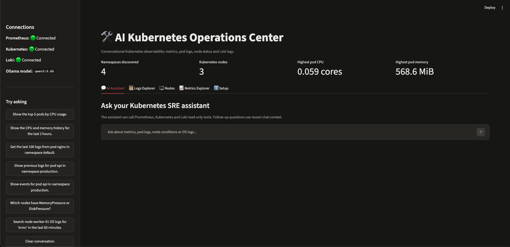

#### This document assume you have already kubernetes cluster installed, prometheus is deployed already, and loki deployed or you can follow for loki below
# AI Kubernetes Operations Center 

Adds Kubernetes pod logs/events/node status, Loki node OS log search, historical Prometheus queries and charts rendered in chat.

## Web UI Preview



## 1. Install Python dependencies

```bash
python3 -m venv .venv
source .venv/bin/activate
pip install -r requirements.txt
cp .env.example .env
```

The default `.env.example` uses `qwen3:0.6b`. You can change `OLLAMA_MODEL` to any model installed locally.

## 2. Start Ollama

```bash
ollama pull qwen3:0.6b
ollama list
```

If the Ollama macOS app is running, you usually do not need a separate `ollama serve`.

## 3. Prometheus

Ensure Prometheus is reachable at `http://localhost:9090` (or update `.env`).

```bash
kubectl get svc -n monitoring
kubectl port-forward -n monitoring svc/prometheus-operated 9090:9090
```

Service name may differ; use the actual Prometheus service shown by `kubectl get svc`.

## 4. Kubernetes API access

The app uses your local kubeconfig. Check:

```bash
kubectl config current-context
kubectl get nodes
kubectl get pods -A
```

The user running Streamlit needs read access to pods, pods/log, events, nodes and namespaces. For a local learning cluster, your existing kubeconfig user may already have sufficient access. In a shared cluster, use a least-privilege read-only Role/ClusterRole; do not grant cluster-admin just for this app.

Optional `.env`:
```env
KUBERNETES_CONTEXT=kind-kind
```

Leave blank to use the current kubeconfig context.

## 5. Loki for node OS logs (optional)

Pod logs work directly through the Kubernetes API. Node OS logs need a log collector; Loki stores and queries logs but does not collect them by itself.

Install a small single-binary Loki for a local learning cluster:

```bash
helm repo add grafana https://grafana.github.io/helm-charts
helm repo update
kubectl create namespace monitoring --dry-run=client -o yaml | kubectl apply -f -
helm upgrade --install loki grafana/loki \
  --namespace monitoring \
  -f observability/loki-values.yaml
```

The values mount a writable `emptyDir` at `/var/loki`, where Loki stores its
filesystem data and ruler state. This is suitable for a local learning cluster;
data is lost when the pod is replaced. For data that must survive pod
recreation, configure `singleBinary.persistence.enabled: true` and provide a
working default or explicit StorageClass instead.

Wait for Loki to become ready:
```bash
kubectl rollout status statefulset/loki -n monitoring
kubectl get pods -n monitoring -l app.kubernetes.io/name=loki
```

Check the service:
```bash
kubectl get svc -n monitoring | grep loki
```

Forward the service:
```bash
kubectl port-forward -n monitoring svc/loki 3100:3100
```

If the chart creates a different service name, use that service. Confirm:
```bash
curl http://localhost:3100/ready
```

### Ship node logs

Review `observability/fluent-bit-node-logs.yaml` before applying. This Kind example reads common host log files under `/var/log` and the systemd journal under `/run/log/journal`, then sends them to Loki with labels:
- `job="node-os"`
- `node="<Kubernetes node name>"`

Apply only after confirming the host log paths and Loki service DNS are correct for your cluster:

```bash
kubectl apply -f observability/fluent-bit-node-logs.yaml
kubectl get pods -n monitoring -l app=fluent-bit-node-logs
kubectl logs -n monitoring -l app=fluent-bit-node-logs --tail=100
```

**Kind limitation:** Kind nodes are Docker containers, not physical hosts. Their OS log paths and journald availability vary by Kind node image. The current `devops-lab` nodes have `/run/log/journal` (not `/var/log/journal`); verify this path on other clusters and node images. This sample does not guarantee kubelet/kernel logs will be present. Check Loki labels and sample queries before relying on it.

Test Loki:
```bash
curl -G 'http://localhost:3100/loki/api/v1/query' \
  --data-urlencode 'query={job="node-os"}'
```

Update `.env`:
```env
LOKI_URL=http://localhost:3100
LOKI_NODE_LABEL=node
```

If you do not install Loki, the rest of the application still works; node OS log search is disabled.

## 6. Run the application

```bash
streamlit run prometheus_app.py
```

## 7. Deploy the web UI in Kubernetes

The app can run as a Pod. For a local kind cluster, build the image locally and
load it into the kind node containers (kind has its own image store; it cannot
automatically see images in the host Docker daemon):

```bash
docker build -t ai-k8s-ops:0.1.0 .
kind load docker-image ai-k8s-ops:0.1.0 --name <kind-cluster-name>
```

Before applying the example manifest:

1. The UI Deployment uses the local image `ai-k8s-ops:0.1.0` and
   `imagePullPolicy: Never`, so Kubernetes will not try to download it. Build
   and load that exact tag into the kind cluster before applying or restarting
   the Deployment. Update the Prometheus and Loki service URLs to the actual
   in-cluster services. Loki is optional; remove `loki_url` if it is not configured.
2. The manifest deploys Ollama in the same namespace as the UI. It pulls the
   model named by `OLLAMA_MODEL` on startup and stores downloaded models on a
   20 GiB PersistentVolumeClaim. Your cluster needs a default StorageClass (or
   edit the PVC to select one). For production, pin the Ollama image to a
   version you have tested and adjust CPU/memory/PVC sizing for your model and
   workload. GPU use requires cluster/vendor-specific resource requests and
   device configuration; this example is CPU-only.
3. Change `OLLAMA_MODEL` in the `ai-k8s-ops-settings` ConfigMap in the
   manifest if you want another model. The same ConfigMap value is used by
   both the Ollama Deployment and UI, so Ollama pulls the model the UI requests.
   `OLLAMA_HOST` points to the in-cluster Ollama Service.
4. Apply the namespace, read-only ClusterRole/Binding, ConfigMaps, UI and
   Ollama Deployments/Services, and model PVC:

   ```bash
   kubectl apply -f deploy/kubernetes.yaml
   kubectl rollout status deployment/ai-k8s-ops -n ai-k8s-ops
   kubectl rollout status deployment/ollama -n ai-k8s-ops
   ```

   If you rebuild the UI image later, load it again and restart the UI Deployment:

   ```bash
   docker build -t ai-k8s-ops:0.1.0 .
   kind load docker-image ai-k8s-ops:0.1.0 --name <kind-cluster-name>
   kubectl rollout restart deployment/ai-k8s-ops -n ai-k8s-ops
   ```

   Then forward the UI Service:

   ```bash
   kubectl port-forward -n ai-k8s-ops svc/ai-k8s-ops 8501:8501
   ```

   Open `http://localhost:8501`. For shared use, expose the Service through an
   authenticated, TLS-protected Ingress rather than making it public directly.

The first Ollama startup downloads the model and may take a while. Monitor it
with `kubectl logs -n ai-k8s-ops deployment/ollama -f`. The Ollama Service is
internal to the cluster; do not expose its API publicly. The model PVC keeps
downloaded files across Ollama Pod replacements. If changing `OLLAMA_MODEL`,
restart both Deployments so their environment variables refresh:

```bash
kubectl rollout restart deployment/ollama deployment/ai-k8s-ops -n ai-k8s-ops
```

The included ServiceAccount permissions are read-only and cover namespaces,
pods, pod logs, events, and nodes. They apply to the cluster where this
manifest is installed. Do not grant `cluster-admin`.

### Configure multiple clusters and observability backends

The UI's **Cluster / environment** selector is populated from
`TARGETS_CONFIG`, a JSON file mounted into the Pod. The example manifest mounts
the ConfigMap at `/etc/ai-k8s-ops/targets.json`. Add one object per selectable
target. If `TARGETS_CONFIG` is unset, the app continues to use the original
single-target `.env` variables.

```json
{
  "targets": [
    {
      "name": "dev-east",
      "prometheus_url": "https://thanos.example.net",
      "prometheus_labels": {"cluster": "dev-east"},
      "loki_url": "https://loki.example.net",
      "loki_labels": {"cluster": "dev-east"},
      "kubernetes_context": "dev-east"
    },
    {
      "name": "prod-west",
      "prometheus_url": "https://thanos.example.net",
      "prometheus_labels": {"cluster": "prod-west"},
      "loki_url": "https://loki.example.net",
      "loki_labels": {"cluster": "prod-west"},
      "kubernetes_context": "prod-west"
    }
  ]
}
```

- `prometheus_labels` adds exact label matchers to every PromQL selector. Set
  the value to the label your central Prometheus-compatible backend uses to
  distinguish clusters. When each target has its own Prometheus endpoint, the
  label filters can be omitted.
- `loki_labels` scopes Loki queries to the target. The app always adds
  `job="node-os"` and the configured node label (`node` by default).
- `kubernetes_context` selects a context from a kubeconfig file. For a target
  that is the cluster hosting this app, use `"in_cluster": true` instead;
  that target uses this Pod's ServiceAccount. Do not set both.
- You can use one shared Prometheus or Loki URL for all targets, as above, if
  those services are network-reachable and their labels are consistent.

For remote Kubernetes contexts, store the kubeconfig as a Secret in the
application namespace; the example Deployment mounts it read-only at
`/etc/remote-kubeconfig/config`:

```bash
kubectl -n ai-k8s-ops create secret generic ai-k8s-ops-kubeconfig \
  --from-file=config=/secure/path/to/kubeconfig
```

Set each target's `kubernetes_context` to a context in that file and grant the
credential used by that context only the read permissions needed by the app
in the corresponding remote cluster. Kubeconfig exec-auth entries need their
external credential plugin installed in the container; this image does not
include cloud-provider CLI plugins. Prefer short-lived credentials or a
central Kubernetes access gateway where available, and rotate credentials.
Do not put kubeconfig credentials in the ConfigMap or commit them.

The target list contains backend addresses and label filters, not credentials.
Prometheus/Loki authentication should be provided by a trusted network,
service mesh, or a separately designed secret-aware authentication mechanism;
do not embed usernames, passwords, or tokens in URLs or the ConfigMap. If you
change the ConfigMap, restart the Deployment to refresh Streamlit's cached
clients:

```bash
kubectl rollout restart deployment/ai-k8s-ops -n ai-k8s-ops
```

Each target has separate chat history in the current browser session. Chat is
in-memory, so it is not persisted across Pod restarts.

## 8. Try these chat questions

```text
Show me the top 5 pods by CPU usage.
Show CPU history for the last 2 hours.
Show memory history for pod api in namespace production for 6 hours.
Get the last 100 logs from pod nginx in namespace default.
Show previous logs for pod api in namespace production.
Show Kubernetes events for pod api in namespace production.
Show the node conditions for worker-01.
Search node worker-01 OS logs for error in the last 60 minutes.
```

Follow-up examples:
```text
Plot memory for that same pod over the last 4 hours.
Do the logs support the memory-pressure hypothesis?
What evidence did you use?
```

## 9. Important behavior and limitations

- Metrics Explorer includes curated pod/node CPU and memory charts plus an
  **All Prometheus metrics** mode that discovers metric names, queries current
  values, and graphs raw samples over a selected 1–24 hour range. Use its
  label-name/value filter to narrow results.
- Prometheus metrics do not consistently expose unit metadata. The explorer
  offers raw, CPU cores, bytes, percent, and seconds display formats; choose
  the one appropriate for the selected metric. CPU values displayed as cores
  represent CPU-seconds-per-second rates. To explore a CPU counter such as
  `container_cpu_usage_seconds_total` as usage, use a `rate()` expression in
  Prometheus or a curated CPU view.
- Historical chat charts are rendered when the assistant calls `get_metric_history`.
- Prometheus history is limited to 1–24 hours per tool call and a 60-second sampling step by default.
- Node CPU/memory queries need Node Exporter metrics.
- Pod logs use Kubernetes `read_namespaced_pod_log`; previous logs are only available if a previous container instance exists.
- Node OS logs use Loki LogQL selector `{job="node-os",node="<node>"}`. Your shipper must use those exact labels, or adjust `LOKI_NODE_LABEL` and the Loki collector.
- This build is read-only. It does not run `kubectl exec`, restart pods, delete resources or change cluster configuration from the chat.
- Logs can contain secrets. Use only test/non-sensitive workloads while learning; consider redaction and access controls before using this with production data.
